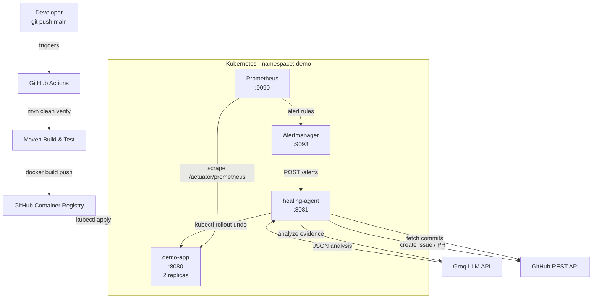
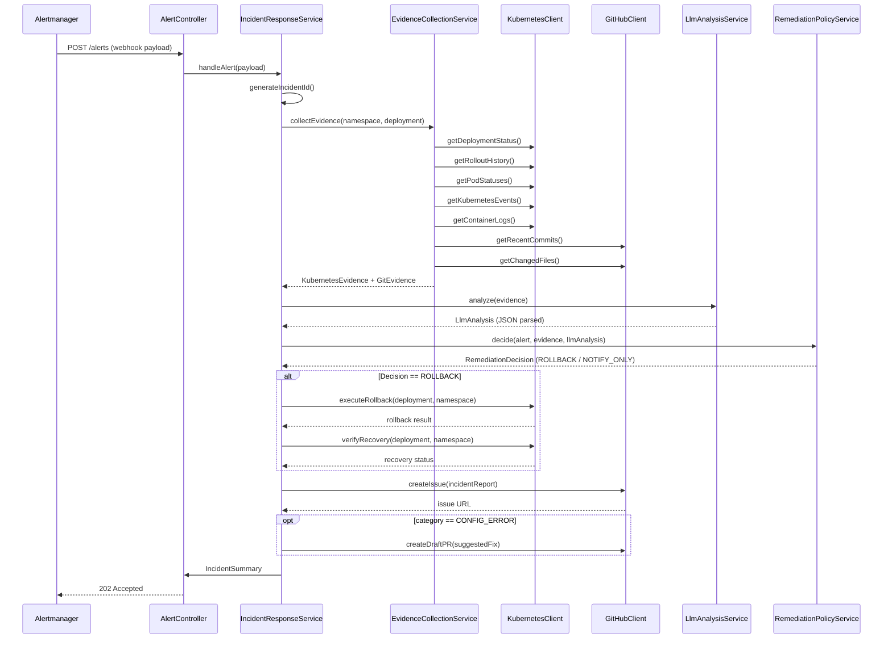

# Design: Self-Healing Deployment Pipeline

## 1. High-Level Architecture

The system is composed of four runtime zones:

| Zone | Components |
|---|---|
| Developer Workstation | Git push → GitHub Actions |
| GitHub | Actions runner, GHCR, Issues, PRs |
| Kubernetes Cluster (kind/minikube) | `demo` namespace: demo-app, healing-agent, Prometheus, Alertmanager |
| External APIs | Groq LLM, GitHub REST API |

```
Developer
   │  git push main
   ▼
GitHub Actions ──────────────────────────────────────────────────────────────┐
   │  1. mvn clean verify                                                     │
   │  2. docker build + push to GHCR                                          │
   │  3. kubectl apply manifests                                               │
   │  4. kubectl rollout status (timeout 5m)                                  │
   │  5. if failed → kubectl rollout undo                                     │
   └──────────────────────────────────────────────────────────────────────────┘

Kubernetes cluster (kind / minikube)  — namespace: demo
┌─────────────────────────────────────────────────────────────────────────┐
│                                                                          │
│  demo-app (2 replicas)              healing-agent (1 replica)           │
│  port 8080                          port 8081                           │
│  /  /fail  /actuator/*              /alerts                             │
│       │ metrics                          │                               │
│       ▼                                  │ executes kubectl              │
│  Prometheus ◄──scrape /actuator/prometheus│ calls GitHub API             │
│       │                                  │ calls Groq API               │
│       │ alert fires                      │                               │
│       ▼                                  │                               │
│  Alertmanager ──── POST /alerts ─────────┘                              │
│                                                                          │
└─────────────────────────────────────────────────────────────────────────┘

External
   ├── Groq API  (LLM root-cause analysis)
   └── GitHub REST API (commits, issues, PRs)
```

---

## 2. Mermaid Architecture Diagram



---

## 3. Component Responsibilities

### 3.1 demo-app

| Responsibility | Detail |
|---|---|
| REST endpoints | `GET /`, `GET /fail` |
| Failure simulation | `FORCE_FAILURE=true` env var flips `/` to fail |
| Observability | Actuator + Micrometer + Prometheus endpoint |
| Custom metrics | `demo_requests_total`, `demo_errors_total` |
| Kubernetes probes | Liveness → `/actuator/health/liveness`, Readiness → `/actuator/health/readiness` |

### 3.2 healing-agent

| Layer | Class(es) | Responsibility |
|---|---|---|
| Controller | `AlertController` | Receives POST /alerts, delegates to service |
| Service | `IncidentResponseService` | Orchestrates the full incident lifecycle |
| Service | `RemediationPolicyService` | Pure Java — decides whether to roll back |
| Service | `EvidenceCollectionService` | Assembles all evidence before calling LLM |
| Client (interface) | `KubernetesClientService` | Queries K8s API / kubectl |
| Client (interface) | `GitHubClientService` | Commits, issues, PRs via GitHub REST |
| Client (interface) | `LlmAnalysisService` | Sends prompt, parses JSON response |
| Client impl | `GroqLlmClient` | Concrete Groq HTTP client |
| Client impl | `GitHubRestClient` | Concrete GitHub REST client |
| Client impl | `KubectlClient` | Concrete kubectl-based K8s client |
| Model | `AlertPayload`, `IncidentReport`, `LlmAnalysis`, `RemediationDecision` | Data classes (records) |
| Config | `HealingAgentProperties` | Reads env vars / application.yml |

### 3.3 Prometheus

- Scrapes `demo-app` every 15 s at `/actuator/prometheus`.
- Evaluates two alert rules (see Section 8).
- Deployed as a `Deployment` with a `ConfigMap` for `prometheus.yml` and `rules.yml`.

### 3.4 Alertmanager

- Receives fired alerts from Prometheus.
- Routes all alerts to `http://healing-agent.demo.svc.cluster.local:8081/alerts`.
- Deployed with a `ConfigMap` for `alertmanager.yml`.

---

## 4. API Contracts

### 4.1 demo-app

#### `GET /`
```
200 OK
Content-Type: application/json
{ "status": "ok", "message": "Hello from demo-app", "version": "1.0.0" }
```

#### `GET /fail`
```
500 Internal Server Error
Content-Type: application/json
{ "status": "error", "message": "Simulated failure" }
```

#### Actuator endpoints (standard Spring Boot)
- `/actuator/health`  → `{ "status": "UP" }`
- `/actuator/health/liveness`
- `/actuator/health/readiness`
- `/actuator/prometheus` → Prometheus text format

---

### 4.2 healing-agent

#### `POST /alerts`  (Alertmanager webhook format)
```json
{
  "version": "4",
  "groupKey": "...",
  "status": "firing",
  "receiver": "healing-agent",
  "groupLabels": { "alertname": "HighErrorRate" },
  "commonLabels": {
    "alertname": "HighErrorRate",
    "namespace": "demo",
    "deployment": "demo-app"
  },
  "commonAnnotations": { "summary": "High error rate in demo-app" },
  "alerts": [
    {
      "status": "firing",
      "labels": { "alertname": "HighErrorRate", "namespace": "demo", "pod": "demo-app-xxx" },
      "annotations": { "summary": "...", "description": "..." },
      "startsAt": "2024-01-01T00:00:00Z",
      "endsAt": "0001-01-01T00:00:00Z",
      "generatorURL": "http://prometheus:9090/..."
    }
  ]
}
```

**Response:**
```
202 Accepted
{ "incidentId": "uuid", "status": "received" }
```

---

### 4.3 LLM Prompt Design

**System prompt:**
```
You are a Kubernetes SRE assistant. Analyze the following incident evidence and return ONLY
valid JSON — no markdown, no explanation outside the JSON object.
```

**User prompt structure:**
```
ALERT: {alertName} in namespace {namespace} on deployment {deployment}
STARTED AT: {startsAt}

=== KUBERNETES EVIDENCE ===
Deployment status: {deploymentStatus}
Recent rollout history:
{rolloutHistory}

Pod statuses:
{podStatuses}

Recent Kubernetes events:
{k8sEvents}

Container logs (last 100 lines per container):
{containerLogs}

=== RECENT GIT COMMITS ===
{recentCommits}

Changed files in last commit:
{changedFiles}

=== REQUIRED JSON RESPONSE FORMAT ===
{
  "rootCause": "one sentence description",
  "confidence": "HIGH|MEDIUM|LOW",
  "category": "CODE_BUG|CONFIG_ERROR|RESOURCE_EXHAUSTION|DEPENDENCY_FAILURE|UNKNOWN",
  "recommendedAction": "ROLLBACK|NOTIFY_ONLY|SCALE_UP|RESTART_PODS",
  "explanation": "3-5 sentence explanation for a developer",
  "evidence": ["key evidence point 1", "key evidence point 2"]
}
```

**Parsing failure policy:** If the response cannot be parsed as the above JSON, the service sets
`category = UNKNOWN`, `confidence = LOW`, `recommendedAction = NOTIFY_ONLY`, and logs the raw response.

---

## 5. Data Flow

### 5.1 Normal Deployment Flow

```
Developer push
  → GitHub Actions: build → test → docker push → kubectl apply
  → K8s: rolling update (2 replicas)
  → Prometheus: scrapes new pods
  → All healthy: no alert fired
```

### 5.2 Failure Detection & Self-Healing Flow

```
demo-app /fail called repeatedly
  → demo_errors_total rises
  → Prometheus evaluates HighErrorRate rule (1 min window)
  → Alert fires → Alertmanager routes to healing-agent POST /alerts
  → healing-agent:
      1. Parse alert payload → extract namespace, deployment
      2. Collect K8s evidence (kubectl get/describe/logs)
      3. Fetch recent commits from GitHub API
      4. Send evidence to Groq → parse JSON response
      5. RemediationPolicyService.decide():
         - Is failure post-deploy? Is previous revision healthy? Not in cooldown?
         → YES → execute kubectl rollout undo → verify with rollout status
         → NO  → NOTIFY_ONLY
      6. Create GitHub Issue with full incident report
      7. (Optional) Create draft PR if category == CONFIG_ERROR
```

---

## 6. Mermaid Sequence Diagram — Incident Response Flow



---

## 7. Kubernetes Resource Design

### Namespace
```yaml
apiVersion: v1
kind: Namespace
metadata:
  name: demo
```

### demo-app Deployment highlights
```yaml
replicas: 2
revisionHistoryLimit: 10
strategy:
  type: RollingUpdate
  rollingUpdate:
    maxSurge: 1
    maxUnavailable: 0
livenessProbe:
  httpGet: { path: /actuator/health/liveness, port: 8080 }
  initialDelaySeconds: 30
  periodSeconds: 10
readinessProbe:
  httpGet: { path: /actuator/health/readiness, port: 8080 }
  initialDelaySeconds: 20
  periodSeconds: 5
```

### healing-agent ServiceAccount & RBAC
```yaml
# ServiceAccount in demo namespace
# ClusterRole (demo namespace only):
#   - deployments: get, list, patch
#   - pods: get, list
#   - pods/log: get
#   - events: get, list
#   - replicasets: get, list   (for rollout history)
```

### Resource limits (both services)
```yaml
resources:
  requests: { cpu: 100m, memory: 256Mi }
  limits:    { cpu: 500m, memory: 512Mi }
```

---

## 8. Prometheus & Alertmanager Design

### Scrape config
```yaml
scrape_configs:
  - job_name: 'demo-app'
    scrape_interval: 15s
    metrics_path: /actuator/prometheus
    static_configs:
      - targets: ['demo-app.demo.svc.cluster.local:8080']
```

### Alert rules

**HighErrorRate**
```yaml
expr: |
  rate(demo_errors_total[1m]) / (rate(demo_requests_total[1m]) + 0.001) > 0.5
for: 1m
labels: { severity: critical, deployment: demo-app, namespace: demo }
annotations:
  summary: "High error rate in demo-app"
  description: "Error rate is {{ $value | humanizePercentage }} for the last minute"
```

**PodNotReady**
```yaml
expr: |
  kube_pod_status_ready{namespace="demo",pod=~"demo-app-.*"} == 0
for: 2m
labels: { severity: warning, deployment: demo-app, namespace: demo }
annotations:
  summary: "demo-app pod not ready"
  description: "Pod {{ $label.pod }} has been not ready for 2 minutes"
```

### Alertmanager webhook route
```yaml
receivers:
  - name: healing-agent
    webhook_configs:
      - url: 'http://healing-agent.demo.svc.cluster.local:8081/alerts'
        send_resolved: false
```

---

## 9. Security Considerations

| Concern | Mitigation |
|---|---|
| Secret management | All credentials via env vars / K8s Secrets; `.env.example` documents keys without values |
| LLM trust boundary | LLM output is parsed JSON only; Java code makes all final decisions |
| RBAC | healing-agent ServiceAccount has minimal permissions scoped to `demo` namespace |
| Container security | Both images run as non-root user (UID 1000) |
| No secrets in Git | `.gitignore` excludes `.env`; GitHub Secrets used in Actions |
| Rollback safety | Multiple guard conditions before any kubectl mutating command |
| Cooldown | In-memory map prevents rollback thrashing (5-minute window) |
| Log safety | Token values are never logged; only key names are referenced |

---

## 10. Testing Strategy

### Unit Tests
| Class | What is tested |
|---|---|
| `RemediationPolicyServiceTest` | All 5 decision branches (rollback allowed, in cooldown, no history, not post-deploy, unknown cause) |
| `AlertPayloadParserTest` | Valid payload, missing labels, malformed JSON, resolved-status alert |
| `LlmAnalysisServiceTest` | Successful parse, JSON parse failure fallback, HTTP error fallback |
| `EvidenceCollectionServiceTest` | Evidence assembly with mocked K8s and GitHub clients |

### Integration Test Placeholders
| Class | Comment |
|---|---|
| `KubernetesClientIntegrationTest` | @Disabled; requires live K8s context; wire with @SpringBootTest + real kubeconfig |
| `GitHubClientIntegrationTest` | @Disabled; requires GITHUB_TOKEN env var and a real repo |

### Verification commands per phase
Each phase includes explicit `curl`, `kubectl`, and `mvn` commands to verify the work done.
