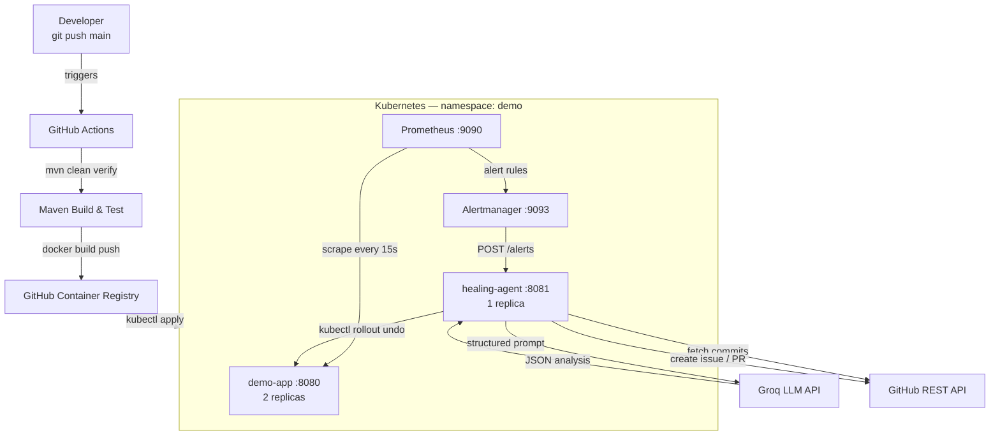
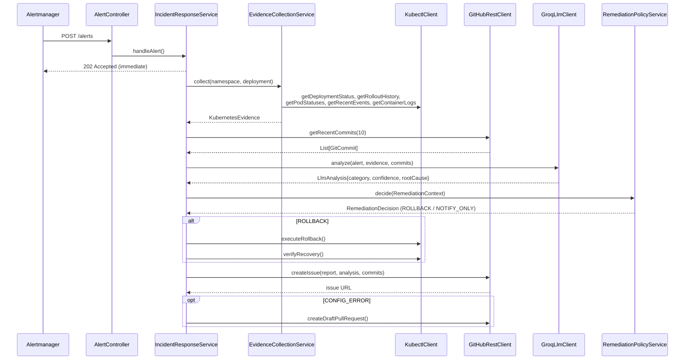

# Architecture

## System Diagram

## Incident Response Sequence

## Components

| Component | Responsibility |
|---|---|
| `demo-app` | Monitored REST service; exposes Micrometer metrics at `/actuator/prometheus` |
| `healing-agent` | Incident responder; orchestrates evidence collection, LLM analysis, remediation |
| `AlertController` | Accepts Alertmanager webhook, returns 202 immediately |
| `IncidentResponseService` | Async pipeline: evidence → commits → LLM → policy → rollback → GitHub |
| `EvidenceCollectionService` | Runs kubectl commands to collect deployment state |
| `RemediationPolicyService` | Pure Java 5-guard safety policy; makes all rollback decisions |
| `GroqLlmClient` | Sends structured prompt to Groq; parses JSON response with fallback |
| `GitHubRestClient` | Fetches commits; creates issues and draft PRs |
| `KubectlClient` | Runs kubectl as subprocess; all args as arrays (no shell injection) |
| Prometheus | Scrapes metrics every 15s; evaluates alert rules |
| Alertmanager | Routes fired alerts to healing-agent webhook |

## Safety Properties

- **LLM is advisory only** — Java policy has final authority over all kubectl commands
- **5 rollback guards** — cooldown, revision history, post-deploy window, plus defaults
- **Shell injection prevention** — all kubectl args passed as `String[]` to `ProcessBuilder`
- **Secrets in K8s Secrets** — never in source code or ConfigMaps
- **Least-privilege RBAC** — healing-agent ServiceAccount scoped to `demo` namespace only
- **Non-root containers** — both Docker images run as UID 1000
